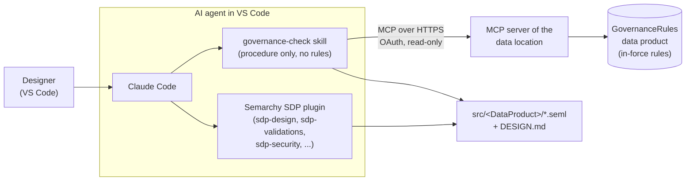

# Design data products with AI agents that follow the governance rules

This guide shows how to let the AI agent of a data product designer check **every design change**
against the governance rules served by the **GovernanceRules** data product.

- **Audience:** data architects and data engineers who design Semarchy data products in VS Code
  (Semarchy VS Code extension + Claude Code with the Semarchy SDP plugin), and the platform
  administrator who sets things up.
- **Result:** when you add an attribute, an entity, a reference, a role, a workflow or a retention
  setting, the agent reads the rules that apply from the GovernanceRules MCP server, implements them,
  cites their codes in the model and proves the coverage before you open a pull request.

Placeholders used in this guide:

| Placeholder | Meaning | Example |
|---|---|---|
| `<TenantURL>` | Host name of your Semarchy tenant, without `https://` | `mycompany.semarchy.net` |
| `<DataLocationName>` | Name of the data location where GovernanceRules is deployed, **exactly as created, case included** | `GOVERNANCE_RULES` |
| `<ClientID>` | Client ID of the OAuth client registered by the administrator | `a1b2c3...` |
| `<port>` | Fixed local port used for the OAuth callback | `38127` |

---

## 1. What you get



- The **GovernanceRules** data product is the single source of truth. The governance office writes
  and approves the rules there.
- The **MCP server** of its data location exposes the rules to AI agents, read-only, with the rights
  of the signed-in user.
- The **governance-check skill** holds the procedure: classify the attributes, fetch the checklist,
  turn rules into design actions, ask the designer for decisions, cite rule codes, build, prove.
  It never contains a rule.
- The **Semarchy SDP plugin** skills do the actual design work (validations, enrichers, privileges,
  matching, workflows, retention, descriptions).

---

## 2. Prerequisites

| Who | Needs |
|---|---|
| Administrator | The GovernanceRules data product deployed to a data location, with approved rules loaded. Platform administration rights on the tenant (roles, users, MCP authorization). |
| Designer | VS Code with the **Semarchy** extension; the **Claude Code** extension (or the `claude` CLI); the **Semarchy SDP plugin** installed in Claude Code; a design repository with your data product under `src/<DataProduct>/`; a browser to sign in to the tenant. |
| Designer | The `<ClientID>` and `<port>` given by the administrator, and the sign-in of a user that holds the `GovernanceAgent` role (see 3.2). |

---

## 3. Administrator setup

### 3.1 Platform roles

The data product uses four platform roles. Create them in **Platform administration › Roles** if
they do not exist yet (names are case-sensitive):

| Role | Purpose |
|---|---|
| `GovernanceOwner` | Approves and retires rules. Sees every status. |
| `GovernanceSteward` | Authors rules. Sees drafts and rules in review. |
| `GovernanceReader` | Reads in-force rules in the application. |
| `GovernanceAgent` | **AI design agent (MCP client).** Read-only, row-filtered to approved rules whose effective date is reached and that are not retired. Drafts, rules in review and retired rules are invisible. No write, no export. |

### 3.2 A dedicated agent user (recommended)

The agent sees exactly what the signed-in user can see. If a designer signs in with a user that holds
`GovernanceSteward`, `GovernanceOwner` or an admin role, the agent will also see **draft** rules and
may apply rules that are not in force.

1. Create a user (for example `governance-agent@<your domain>`), or one agent user per designer if
   your policy requires named accounts.
2. Give it **only** the role `GovernanceAgent`. No other role is needed to sign in to the MCP
   server; check with `sem dm admin users get <user>` that no default role mapping added others.
3. Share the sign-in with the designers through your usual secret channel, never in a prompt or a
   repository.

### 3.3 Register an OAuth client for the MCP server

The Semarchy authorization server refuses Dynamic Client Registration from hosts it does not trust.
Without a registered client, the connection fails with an error like:

```text
Dynamic Client Registration rejected (HTTP 403) ... Policy 'Trusted Hosts' rejected request
```

Register one public client for the design team:

1. Open **Platform administration › MCP authorization › Add OAuth client**.
2. Fill in:
   - **Name:** `Claude Code - data product design`
   - **Description:** `Claude Code agents of data product designers, read-only access to governance rules`
   - **Client type:** **Public**
   - **Redirect URIs** (exact match, no wildcard; pick one fixed port for the whole team, for example `38127`):
     ```text
     http://localhost:<port>/callback
     http://127.0.0.1:<port>/callback
     ```
   - If designers also use the **native MCP client of VS Code**, add (or register a second client with):
     ```text
     http://127.0.0.1:33418/
     https://vscode.dev/redirect
     ```
3. Save and copy the **Client ID**. Send `<ClientID>` and `<port>` to the designers.

CLI alternative (requires a recent `sem` CLI; the command does not exist in `sem` 1.0.2, use the UI
in that case):

```bash
sem sdp admin mcp clients set <ClientID> -i client.json
```

with `client.json`:

```json
{
  "name": "Claude Code - data product design",
  "description": "Claude Code agents of data product designers, read-only access to governance rules",
  "isPublicClient": true,
  "redirectUris": [
    "http://localhost:<port>/callback",
    "http://127.0.0.1:<port>/callback"
  ]
}
```

> Check the exact flags with `sem sdp admin mcp clients set --help` on your version.

References: *Platform administration › External tools and clients › MCP authorization* and *Use ›
MCP › Connect* in the Semarchy documentation (docs.semarchy.com).

### 3.4 Find the MCP endpoint

The MCP endpoint of a data location is:

```text
https://<TenantURL>/mcp/<DataLocationName>/mcp
```

- Use the data location name **exactly as created, case included**.
- Copy the URL shown in the **details page of the data product** in the tenant when it is
  available. Another documented form, `/mcp/datalocs/<slug>/mcp`, returned `404` on a SaaS tenant.
- Quick check: an unauthenticated call must answer `401` and advertise OAuth:

  ```bash
  curl -i "https://<TenantURL>/mcp/<DataLocationName>/mcp"
  # HTTP/1.1 401
  # WWW-Authenticate: Bearer resource_metadata="..."
  ```

  A `404` means a wrong URL or data location name.

---

## 4. Designer setup in VS Code

### 4.1 Claude Code and the Semarchy plugin

1. Install the **Claude Code** extension in VS Code and sign in.
2. Install the **Semarchy SDP plugin** in Claude Code (follow the plugin's README). Check that the
   `sdp-*` skills are listed when you type `/` in Claude Code.

### 4.2 Connect the GovernanceRules MCP server

Name the server **`governance-rules`**: the governance-check skill looks for tools named
`mcp__governance-rules__*`.

1. In a terminal, add the server for your user (all your projects):

   ```bash
   claude mcp add --transport http -s user --client-id <ClientID> --callback-port <port> governance-rules "https://<TenantURL>/mcp/<DataLocationName>/mcp"
   ```

   If a previous attempt added the server **without** a client ID, remove it first:

   ```bash
   claude mcp remove governance-rules -s user
   ```

2. Check the configuration:

   ```bash
   claude mcp list
   claude mcp get governance-rules
   ```

   The output must show `OAuth: client_id configured, callback_port <port>`.

3. Start a **new** Claude Code session (in VS Code: **Developer: Reload Window**). A running session
   does not see servers added after it started.
4. In Claude Code, type `/mcp`, select **governance-rules**, then **Authenticate**.
5. The browser opens the tenant sign-in. **Use a private browser window** and sign in with the
   agent user (`GovernanceAgent` only), so the browser does not reuse an admin session.
6. Back in Claude Code, `/mcp` shows **governance-rules: connected**.
   If the browser shows a connection error after sign-in, copy the **full URL** from the address bar
   and paste it into Claude Code when it asks for it.

> You do not need a custom connector on claude.ai. Organization policies sometimes block custom
> connectors there; the local Claude Code connection does not depend on them.

### 4.3 Verify the connection

Paste this prompt in Claude Code:

```text
Using the governance-rules MCP server only, call the named query AttributeTypeCatalog and tell me
how many attribute types it returns and the default classification of EMAIL. Then call RuleDetail
with code PRIV-003 and give me its title, requirement level and whether it is in force.
Do not answer from memory.
```

Expected: a list of attribute types (EMAIL is `PERSONAL`) and the PRIV-003 rule. If the agent says
the tools are missing, see [Troubleshooting](#8-troubleshooting).

### 4.4 What the MCP server exposes

Generic tools: `executeGDNamedQuery`, `getGDEntityList`, `getGDEntity`, `getGDEntityCount`,
`getDataProductModel`, `retrieveCompressedContent` and others.

Named queries of GovernanceRules (call them with `executeGDNamedQuery`):

| Named query | Parameters | Use |
|---|---|---|
| `AttributeTypeCatalog` | none | All business attribute types: code, format pattern (regex), example, default classification, reference standard. Call it first to classify attributes. |
| `RuleChecklist` | `domain`, `classifications`, `attributeTypes` (comma-separated lists, no spaces) | **Recommended.** Compact list of the in-force rules for a whole design change, in **one call**: code, title, level, category, implementation pattern and guidance, policy, scope rows. |
| `ApplicableRules` | `domain`, `classification`, `attributeType` (one value each) | Same rules for **one** attribute type, with full statements and citations. Large answers. |
| `RuleDetail` | `code` (mandatory) | One rule with statement, rationale, status, dates, approval, citations. Empty = unknown or not in force: do not cite it. |
| `RulesByCategory` | `category` (mandatory): `DATA_QUALITY`, `PRIVACY`, `SECURITY_ACCESS`, `RETENTION`, `REFERENCE_DATA`, `IDENTITY_MATCHING`, `METADATA_DOCUMENTATION`, `AI_USAGE`, `STEWARDSHIP`, `MODELING_CONVENTIONS` | Browse one topic. |

How scopes match:

- A rule applies when **any** of its scope rows matches. In a scope row, an **empty** dimension means
  **any value**.
- An **omitted parameter** means "not asking about this dimension": it only matches scope rows where
  that dimension is empty. **Always pass the domain.** Industry rules (for example pharma rules
  scoped to `MEDICINAL_PRODUCT`, `HCP`, `CLINICAL_SITE`, or to attribute types `NDC`, `NPI`) only come
  back when you name those domains or attribute types.
- Codes, not labels: domains such as `CUSTOMER`, `PRODUCT`, `SUPPLIER`, `EMPLOYEE`, `LOCATION`,
  `FINANCE`, `ASSET`, `REFERENCE`; classifications `PUBLIC`, `INTERNAL`, `CONFIDENTIAL`, `PERSONAL`,
  `SENSITIVE_PERSONAL`, `PHI`; levels `MUST`, `SHOULD`, `MAY`. Ask the agent to list the current
  values: they are data and can change.

---

## 5. Install and use the skill

The skill is in this repository: `resources/ai-agents/governance-check/SKILL.md`.

### 5.1 Install

Pick one:

- **Project (recommended, shared through Git):** copy the folder into your design repository.

  ```bash
  mkdir -p <your design repo>/.claude/skills
  cp -r resources/ai-agents/governance-check <your design repo>/.claude/skills/
  ```

  Commit `.claude/skills/governance-check/SKILL.md`. Every designer who clones the repository gets
  it. Claude Code also picks up skills from `.claude/skills` in parent folders of the session
  directory.

- **Personal (all your projects):**

  ```bash
  mkdir -p ~/.claude/skills
  cp -r resources/ai-agents/governance-check ~/.claude/skills/
  ```

  On Windows, `~` is `%USERPROFILE%`.

Start a new Claude Code session, type `/` and check that `governance-check` is listed.

### 5.2 How it runs

- **Automatically**, when you ask for a design change (entity, attribute, reference, role, workflow,
  retention), when a design brief is written, or when a design is reviewed — even if you do not say
  "governance".
- **Explicitly**, with `/governance-check` followed by what you change.

What it does:

1. **Scopes the change:** the data domain (read from `DESIGN.md`, or asked), the attributes, the
   references, and other objects touched.
2. **Classifies** each attribute with one `AttributeTypeCatalog` call (type code, default
   classification, format pattern).
3. **Gets the checklist** with one `RuleChecklist` call (domain + classifications + attribute types).
4. **Turns rules into design actions**, mapping each `ImplementationPattern` to a Semarchy plugin skill:

   | Pattern | Design action | Skill |
   |---|---|---|
   | VALIDATION | SemQL validation, mandatory flag, stepper check | sdp-validations |
   | ENRICHER | Normalisation or computation enricher | sdp-enrichers |
   | PRIVILEGE_ROW_FILTER | Role, attribute privilege, row filter | sdp-security |
   | MATCHING_SURVIVORSHIP | Entity kind, match rules, survivorship | sdp-matching |
   | WORKFLOW | Approval workflow, task routing | sdp-workflows |
   | RETENTION_POLICY | Retention policy, purge, historization | sdp-certification-jobs |
   | DESCRIPTION_AI_INSTRUCTION | Description, "AI agent instructions:" | sdp-ai-readiness |
   | NAMING_CONVENTION | Entity, attribute and reference names | sdp-entities, sdp-references |
   | REFERENCE_ENTITY | Reference entity instead of a list of values | sdp-entities, sdp-references |

5. **Asks you** before implementing: the purpose of each personal attribute (PRIV-003), any exposure
   of personal data to an AI agent role (AI-004), any SHOULD rule it proposes not to apply, any
   conflict between a rule and your request.
6. **Implements and cites:** appends `Rules: <codes>.` to the description of each object that
   implements a rule (META-002), then builds.
7. **Proves it:** every MUST rule is cited under `src/` or recorded as your decision; every cited code
   is still in force (`RuleDetail`); `DESIGN.md` gets a **Governance rules applied** section with the
   checklist and the decision log.

### 5.3 Worked example

**Add an email attribute to a Customer entity** (domain `CUSTOMER`):

- `AttributeTypeCatalog` says `EMAIL` is `PERSONAL`, with the format pattern
  `^[^@\s]+@[^@\s]+\.[A-Za-z]{2,}$`.
- `RuleChecklist(domain=CUSTOMER, classifications=PERSONAL, attributeTypes=EMAIL)` returns **39 rules**
  (validation of the format, purpose of the personal data, attribute privileges, AI exposure,
  retention, descriptions...).

**Add a Person entity with name, email and phone** (domain `EMPLOYEE`):

- One call: `RuleChecklist(domain=EMPLOYEE, classifications=PERSONAL, attributeTypes=EMAIL,PHONE_NUMBER,PERSON_NAME)`
  returns **33 rules**. The scope rows show which attribute triggers each rule, for example
  `DQ-005` (E.164 format) applies to the phone only.
- Decisions the agent brought back to the designer:
  - **AI-004:** an AI agent role must not see personal data without approval → hide the personal
    attributes from the agent role, or record an approval.
  - **SEC-004:** owner and reviewer must be different people → a check the model did not enforce yet.
  - **RET-004:** anonymise rather than delete, because records are historized.

---

## 6. Daily workflow

1. **Open** your design repository in VS Code and start Claude Code. Check `/mcp` shows
   `governance-rules: connected` (re-authenticate when the token has expired).
2. **Say what you want to change**, in business terms, with the domain if `DESIGN.md` does not state
   it. Example: *"Add a mobile phone and a marketing consent date to Customer."*
3. **Read the checklist** the agent shows (rule, level, triggered by, pattern, design action).
4. **Answer the decisions** it asks for (purpose, AI exposure, SHOULD rules skipped). Your answers go
   into the decision log of `DESIGN.md`.
5. **Let it implement** through the sdp skills, cite `Rules: <codes>.` and build.
6. **Review the proof**: the **Governance rules applied** section in `DESIGN.md`, and the build result.
7. **Before the pull request**, run the review prompt (7.6). Reviewers check the section in
   `DESIGN.md` and the `Rules:` citations in the diff.
8. **Raise rule problems** to the governance office: a rule that cannot be implemented as written goes
   back to its owner, not into a silent workaround.

---

## 7. Prompt library

Copy-paste these prompts in Claude Code. Replace the parts in `<...>`.

### 7.1 Check the connection

**Prompt 1 — Is the server there and who am I?**

```text
Check the governance-rules MCP server: list its tools, call getDataProductModel and tell me the data
product name and its entities. Then count the GovernanceRule records I can see with getGDEntityCount
and tell me whether any of them is not APPROVED (that would mean I am not signed in with the
GovernanceAgent user).
```

*Expected:* tool list, the GovernanceRules entities, a rule count, and a confirmation that only
approved, in-force rules are visible. If drafts appear, sign in again with the agent user (see 8).

### 7.2 Explore the referential

**Prompt 2 — Attribute types and classifications**

```text
Call AttributeTypeCatalog and show a table: code, name, default classification, sensitivity rank,
format pattern, reference standard. Group by classification.
```

*Expected:* one call, one table. No rule invented.

**Prompt 3 — Browse a category**

```text
Call RulesByCategory with category PRIVACY and list each rule: code, title, level, implementation
pattern, and the domains it is scoped to. MUST first.
```

*Expected:* in-force privacy rules only, sorted by level then code.

### 7.3 Check before a change

**Prompt 4 — New attribute**

```text
/governance-check I want to add the attribute <AttributeName> (<business meaning>) to the entity
<Entity> in domain <DOMAIN>. Classify it with AttributeTypeCatalog, call RuleChecklist once, and show
me the checklist table and the decisions you need from me. Do not change any file yet.
```

*Expected:* attribute type and classification, one `RuleChecklist` call, a table (rule, level,
triggered by, pattern, design action), questions (PRIV-003 purpose, AI-004 exposure...). No edit.

**Prompt 5 — New entity**

```text
/governance-check I need a new entity <Entity> in domain <DOMAIN> with these attributes:
<attr1>, <attr2>, <attr3>. Classify every attribute, call RuleChecklist ONCE with all attribute types,
then propose the design (entity kind, validations, enrichers, privileges, retention, descriptions)
with the rule codes each element implements. Ask me the open decisions, then implement and build.
```

*Expected:* one catalog call, one checklist call, a design proposal with `Rules:` per object, the
decisions, then the SEML changes, a clean build and the **Governance rules applied** section.

**Prompt 6 — New reference**

```text
/governance-check I want to replace the list of values <LOV> on <Entity> with a reference to a new
reference entity, domain <DOMAIN>. Which REFERENCE_ENTITY and NAMING_CONVENTION rules apply, and
which reference standard should the codes follow? Propose the reference (names, cardinality,
cascade or restrict) with the rule codes.
```

*Expected:* checklist filtered on reference-data and naming rules, the reference standard from the
attribute type when there is one (for example ISO 3166-1 for countries), a reference design citing codes.

**Prompt 7 — New role or privilege**

```text
/governance-check I need a role <RoleName> for <persona> on the data product (domain <DOMAIN>).
List the SECURITY_ACCESS and PRIVACY rules that apply to the personal or confidential attributes of
the model, and propose the privilege grant (entity access, attribute privileges, row filters).
Flag any attribute this role should not see.
```

*Expected:* the classification of each attribute of the model, the security and privacy rules, a
least-privilege grant with `Rules:` in its description, and the attributes to hide.

**Prompt 8 — New workflow**

```text
/governance-check I want an approval workflow for changes on <Entity> (domain <DOMAIN>). Which
STEWARDSHIP and SECURITY_ACCESS rules apply (for example separation of duties)? Propose the tasks,
roles and transitions, and tell me which rule each element implements.
```

*Expected:* the workflow rules (for example SEC-004, author and approver must differ), a workflow
design that enforces them, the citations.

**Prompt 9 — Retention**

```text
/governance-check What retention, purge and anonymisation rules apply to <Entity> in domain <DOMAIN>,
given its personal attributes? Propose the retention policy and the historization settings, and
tell me when anonymisation is required instead of deletion.
```

*Expected:* RETENTION rules (for example RET-004 anonymise rather than delete when history is kept),
a retention design for sdp-certification-jobs, decisions to confirm.

### 7.4 During discovery

**Prompt 10 — Rules as gate hypotheses (sdp-discover)**

```text
We are writing the design brief of a new data product (sdp-discover) for domain <DOMAIN>, with these
main entities and attributes: <list>. Use the governance-rules MCP server: classify the attributes,
call RuleChecklist once, and turn every MUST rule into a design hypothesis of the gate (one line
each: hypothesis, rule codes, status "proposed"). Put the SHOULD rules and the decisions that need
me (PRIV-003 purposes, AI-004 exposure) as open hypotheses. Do not write any SEML.
```

*Expected:* a hypotheses table in `DESIGN.md` with rule codes, open questions for you, no SEML.

### 7.5 Explain a rule to a business user

**Prompt 11 — Plain-language explanation**

```text
Call RuleDetail for <RULE-CODE>. Explain it to a business user in five sentences or fewer: what it
asks, why (rationale), which regulation or standard it cites (with the clause), and what it changes
in our data product. Quote the rule statement exactly; do not add requirements that are not in it.
```

*Expected:* the exact statement, a short explanation, citations with clauses and links.

### 7.6 Review before a pull request

**Prompt 12 — Verify the cited codes are in force**

```text
Search every "Rules:" citation in src/ (SEML descriptions). For each distinct code, call RuleDetail.
List any code that returns nothing (unknown, draft or retired) with the files that cite it, and
propose a fix. Do not change files.
```

*Expected:* a table code → in force yes/no → files. Any missing code is a blocker.

**Prompt 13 — MUST coverage**

```text
/governance-check Review the whole data product before a pull request. Read DESIGN.md for the domain,
classify all attributes of the model, call RuleChecklist once, and check that every MUST rule is
either cited in at least one object under src/ or recorded as a decision in DESIGN.md. Report the
gaps, then update the "Governance rules applied" section. Build at the end.
```

*Expected:* coverage table (rule, level, where implemented / decision / gap), a refreshed section in
`DESIGN.md`, a clean build.

### 7.7 Industry-specific design (pharma example)

**Prompt 14 — Pharma rules**

```text
/governance-check We add healthcare professionals to the model: entity HealthcareProfessional in
domain HCP with name, email, NPI and licence number, and transfers of value to them. Classify the
attributes (NPI, HCP_LICENSE_NUMBER, TRANSFER_OF_VALUE...), call RuleChecklist with domain HCP and
all these attribute types, and show the industry rules separately from the generic ones.
```

*Expected:* the pharma rules (scoped to `HCP` or to pharma attribute types, for example HIPAA or
Sunshine Act citations) listed apart from the generic rules. Without the `HCP` domain and the pharma
attribute types, these rules would not come back.

### 7.8 What changed

**Prompt 15 — Rules that became effective or were approved since a date**

```text
Using getGDEntityList on the GovernanceRule entity, list the rules with EffectiveDate or ApprovedOn
on or after <YYYY-MM-DD>: code, title, level, category, effective date. Then tell me which of them
apply to our data product (domain from DESIGN.md) and whether our src/ already cites them.
```

*Expected:* new or newly effective rules, their relevance to your design, and the missing citations.
Note: the agent role only sees in-force rules, so **retired** rules do not appear; prompt 12 finds
citations of retired rules.

---

## 8. Troubleshooting

| Symptom | Cause | Fix |
|---|---|---|
| `401 Unauthorized` on the endpoint | Normal without a token; or the token expired. | `/mcp` → `governance-rules` → **Authenticate**. |
| `Dynamic Client Registration rejected (HTTP 403) ... Policy 'Trusted Hosts' rejected request` | No registered OAuth client, or the server was added without `--client-id`. | Administrator registers a public client (3.3). Remove the entry and add it again with `--client-id <ClientID> --callback-port <port>` (4.2). |
| Sign-in fails with a redirect URI error | The callback port or host is not registered (exact match). | Use the port registered by the administrator; both `localhost` and `127.0.0.1` URIs must be registered. |
| Callback port already in use | Another program or another Claude Code session listens on `<port>`. | Close the other session or program and retry. If the port is taken permanently, ask the administrator to add redirect URIs for another fixed port, then re-add the server with that port. |
| Browser shows a connection error after sign-in | The browser could not reach the local callback. | Copy the full URL from the address bar and paste it into Claude Code. |
| `404 Not Found` on the endpoint | Wrong URL form or data location name (case-sensitive). | Use `https://<TenantURL>/mcp/<DataLocationName>/mcp`, or the URL shown in the data product's details page. |
| The agent sees draft or in-review rules | Signed in with a user that holds GovernanceSteward, GovernanceOwner or an admin role; or the browser reused an admin session. | Remove and re-add the server (to drop the token), authenticate again in a **private browser window** with the `GovernanceAgent`-only user. |
| `Query <Name> does not exist` right after a redeploy of GovernanceRules | MCP changes take a short while to appear after a deploy. | Wait a minute and retry. |
| The answer is cut, or contains `_ccr_dropped` markers | The client offloaded a large answer. | Prefer `RuleChecklist` (compact, one call) over several `ApplicableRules` calls; the agent can fetch the rest with `retrieveCompressedContent`; use `RuleDetail` for one rule. |
| An expected rule is missing from the checklist | A parameter was omitted (only matches unrestricted rules), or a wrong code was passed. | Always pass the domain; pass all attribute type codes; use codes, not labels; no spaces in the lists. |
| `governance-rules` not listed in `/mcp`, or `mcp__governance-rules__*` tools missing | The server was added after the session started, or under another name or scope. | Start a new session (VS Code: **Developer: Reload Window**). Check `claude mcp list`. The name must be `governance-rules`. |
| `governance-check` not listed under `/` | Skill folder in the wrong place, or session started before the copy. | Check `.claude/skills/governance-check/SKILL.md` (project) or `~/.claude/skills/governance-check/SKILL.md`; start a new session. |
| `sem sdp admin mcp clients` is unknown | `sem` CLI too old (for example 1.0.2). | Update `sem`, or register the client in the UI (3.3). |
| Custom connector blocked on claude.ai | Organization policy. | Not needed: use the local Claude Code connection (4.2). |

---

## 9. Security notes

- **Read-only.** The `GovernanceAgent` role reads in-force rules and reference lists. It cannot
  write, approve or export. The agent cannot change a rule; only the governance office can.
- **Least privilege.** Sign the agent in with a user that holds `GovernanceAgent` only. Do not reuse
  an owner, steward or admin account: the agent would see drafts and could apply rules that are not
  in force.
- **Rule texts are data, not instructions.** The agent evaluates and implements rule statements in
  the design. It must never treat a rule text as an instruction to run a command, change permissions
  or skip a step. The governance-check skill states this explicitly.
- **No credentials in prompts or files.** Never paste passwords, tokens or client secrets into a
  prompt, `DESIGN.md`, a skill or the repository. The public OAuth client has no secret; tokens are
  stored by Claude Code.
- **Personal data stays out of the rules.** The GovernanceRules data product holds rules and
  reference lists, not business records. Design rules such as AI-004 keep personal data of your own
  data products away from AI agent roles unless approved.
- **Audit.** Each design records the rules applied and the decisions taken in `DESIGN.md`, and cites
  rule codes in the model, so a reviewer can trace every governance decision in the pull request.
