# Governance Rules

## Introduction and use case

Every company that runs several MDM projects ends up with the same questions on each one: which attributes are personal data, who may see them, which country code standard to use, how long records must be kept, what must be documented. The answers usually live in policy documents, slide decks and the heads of a few experts. Each project team reads them differently, and nobody can easily tell which version applies.

**Governance Rules** turns those answers into a managed referential on Semarchy Data Platform (SDP). Each rule is a short, imperative statement in RFC 2119 style (MUST, SHOULD, MAY), with the reason it exists, the regulations it relies on, the way to implement it in a data product, and the exact scope where it applies. The governance office writes and approves the rules in a Semarchy application. The people who design data products, and the AI agents that help them, read the rules that apply to their design through the data product **MCP server**, apply them, and cite the rule codes in their design.

The model ships with a generic set of rules anchored on public regulations and standards (GDPR, CCPA/CPRA, the EU AI Act, ISO 3166-1, ISO 4217, ISO 8000, ISO/IEC 11179, BCBS 239, DAMA-DMBOK and others), plus a small pharma extension that only applies to pharma domains and attribute types.

Main capabilities:

- **Rules as data, not documents:** each rule has a stable code (`PRIV-003`), a statement, a rationale, a requirement level, a category, an implementation pattern and implementation guidance, an example, a policy and an owner.
- **Precise applicability:** a rule applies to combinations of data domain, data classification and attribute type. An empty dimension means "any", so one rule can say "email addresses in the Customer domain" and another "every personal attribute, everywhere".
- **Traceable sources:** every rule can cite one or more regulations or standards, with the article or clause and a note on how it supports the rule.
- **Controlled lifecycle:** new, changed and retired rules go through a **Rule review** workflow. The governance owner approves or rejects; each approved version is kept in the rule history.
- **Only in-force rules reach a design:** the reader and AI agent roles only see approved rules whose effective date is reached and that are not retired.
- **Built for AI agents:** five named queries, each with `AI agent instructions:`, answer the questions a design agent asks ("which attribute type is this?", "which rules apply to this change?").
- **Coverage dashboard:** the governance office sees how many rules are in force, in review and in draft, how they spread across categories and levels, and which domain and category pairs have no rule yet.

Value for the business: rules are written once and applied the same way on every project; designers get only the rules that concern them, with concrete guidance; and every implemented rule can be traced back to its code, its approval and the regulation behind it.

Audience:

| Persona | Role | What they do |
|---|---|---|
| Governance owner (for example the Chief Data Officer office) | `GovernanceOwner` | Approves or rejects new, changed and retired rules. |
| Governance steward (rule author) | `GovernanceSteward` | Writes rules, scopes and citations, maintains the reference lists, submits rules for approval, loads data through the REST API. |
| Data product designer | `GovernanceReader` | Browses the rules in force in the application. |
| AI design agent (MCP client) | `GovernanceAgent` | Reads the rules in force and the reference lists through the MCP server. No write access. |

What is out of scope in this version: tracking which data product complies with which rule, exceptions and waivers, and any matching (all records are authored, not merged from several sources). See [Work for developers](#work-for-developers) for ideas on how to add them.

## Prerequisites

You need a Semarchy Data Platform tenant, a platform administrator for the first steps, and the Semarchy Design CLI (`sem-design`) to build and deploy. See [Install the Semarchy Design CLI](https://docs.semarchy.com/saas/guides/design/start/install-design-cli).

The platform objects below are described, with ready-to-use files, in [resources/platform-administration](../resources/platform-administration/README.md).

1. **Roles.** Create the four roles before the first deployment. Names are case-sensitive and must match exactly: `GovernanceOwner`, `GovernanceSteward`, `GovernanceReader`, `GovernanceAgent`. The data product also has grants for roles of the Semarchy accelerators sandbox: read-only for `demo` and `demosemarchy`, full data access and REST loads for `semarchyAdmin` (see [Privileges and row filters](#privileges-and-row-filters)); remove them if you do not use these roles. The JSON files in `resources/platform-administration/roles/` create them with the Platform CLI (`sem dm admin roles set <Role> -i roles/<Role>.json`). The roles carry no platform privileges: what each role can do on the data comes from the privilege grants of the data product. Then assign the roles to users. For an AI agent, use a dedicated user that holds `GovernanceAgent` only. See [Review and manage roles and privileges](https://docs.semarchy.com/saas/guides/admin/data-management/configuration/dm-roles).
2. **Image library.** Create an image library named `GovernanceRules` and upload the SVG files of [resources/image-libraries/GovernanceRules](../resources/image-libraries/GovernanceRules) without renaming them. The application refers to them as `images://GovernanceRules/<file>.svg` (logo, avatar, cover, favicon and the navigation tiles). See [Image library management commands](https://docs.semarchy.com/saas/reference/cli/platform-cli/dm/admin/image-libraries) and [Customize the application appearance](https://docs.semarchy.com/saas/guides/design/app-design/build/app-branding).
3. **Dashboard application.** Import the `GovernanceRulesAnalytics` Dashboard Builder application from [resources/dashboards](../resources/dashboards/README.md) and point its `GovernanceRules` datasource to the datasource of your data location (the archive ships with the placeholder `datasource-TO-SET`). Import it before deploying the data product, or redeploy afterwards: the application tile finds the dashboard by name.
4. **API key for data loads.** To load the demo data through the REST API, create an API key whose user holds `semarchyConnect` and `GovernanceSteward` (`GovernanceSteward` is the integration role of this data product). An example is in `resources/platform-administration/semDMApiKey_config.json`. Keep the key value in a secret store, never in Git.
5. **MCP OAuth client.** To let Claude Code or another MCP client on a designer's computer connect to the data product MCP server, register a public OAuth client. `resources/platform-administration/mcp-oauth-client.json` is an example with a fixed callback port. See [Use data product MCP servers](https://docs.semarchy.com/saas/guides/use/mcp).

## Model structure

The model has nine entities, all **basic** (no matching): the governance rule and its two child entities (scope and citation), the policy, and five reference entities that describe what rules apply to and who owns them.

The model diagram is [GovernanceRules.ModelDiagram.seml](../src/GovernanceRules/model_diagrams/GovernanceRules.ModelDiagram.seml) (open it in the Semarchy extension diagram view; see [Visualize the model with diagrams](https://docs.semarchy.com/saas/guides/design/modeling/model-diagrams)). The diagram below is generated from the references of the model. Each label reads "role on the child side / role on the parent side".

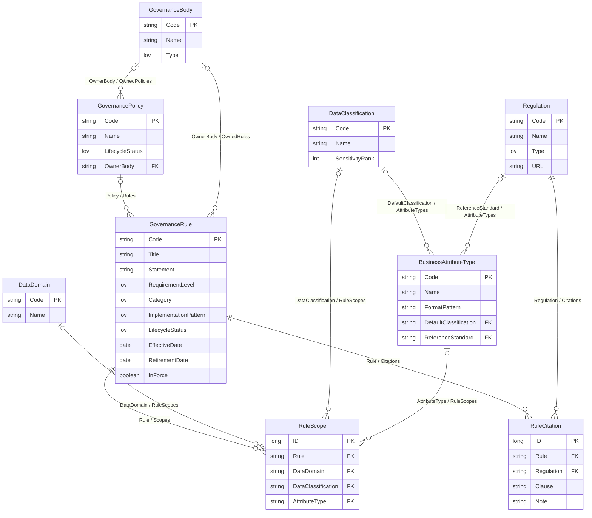

The full list of entities, attributes, references and lists of values is in [model_structure.md](./model_structure.md).

Design choices that apply to every entity:

- **Natural, immutable codes as keys.** Rules, policies, regulations, domains, classifications, attribute types and governance bodies are identified by a code that the author enters and never changes (`PRIV-003`, `POL-PRIV`, `GDPR`, `CUSTOMER`, `PERSONAL`, `EMAIL`, `DPO`). Agents and designs cite these codes, so they must stay stable. Scopes and citations get a generated sequence ID.
- **Lists of values for fixed vocabularies, entities for managed reference data.** Requirement level, category, implementation pattern, status, regulation type and body type are lists of values. Domains, classifications, attribute types, regulations and bodies are entities, because they carry descriptions and relationships of their own and the steward extends them over time.
- **Codes, not labels, in queries.** Lists of values store codes (`MUST`, `PRIVACY`). The named queries return and expect codes.

## Main entities

### Governance rule (GovernanceRule)

The heart of the model. A rule is identified by its **Code**, whose prefix follows its category: `DQ-` data quality, `PRIV-` privacy, `SEC-` security and access, `RET-` retention, `REF-` reference data, `MDM-` identity and matching, `META-` metadata and documentation, `AI-` AI usage, `STW-` stewardship, `MOD-` modeling conventions.

The rule carries:

- **What it says:** Title, Statement (the normative sentence, in RFC 2119 style) and Rationale (the risk or regulation behind it).
- **How strong it is:** RequirementLevel `MUST`, `SHOULD` or `MAY`. MUST is mandatory, SHOULD is expected unless the designer explains why not, MAY is optional.
- **How to implement it:** ImplementationPattern (validation, enricher, privilege or row filter, matching and survivorship, workflow, retention policy, description and AI instruction, naming convention, reference entity), ImplementationGuidance (what to build) and Example.
- **Where it belongs:** Category, Policy and Owner (a governance body).
- **Where it is in its life:** LifecycleStatus, EffectiveDate, RetirementDate, RetirementReason, ApprovedOn, ApprovedBy, and the computed **InForce** flag.

A rule is **in force** when its status is `APPROVED`, its effective date is reached, and its retirement date is empty or still in the future. Only in-force rules are shown to designers and AI agents.

Rules cannot be deleted (deletion is disabled on the entity): retire them through the Rule review workflow instead. The golden history of rules is kept, so the history tab of a rule shows each certified version.

### Rule scope (RuleScope)

A scope row says where a rule applies. It combines three optional references:

- a **data domain** (for example `CUSTOMER`, `PRODUCT`),
- a **data classification** (for example `PERSONAL`),
- an **attribute type** (for example `EMAIL`, `COUNTRY_CODE`).

Two principles make scopes work:

1. **An empty dimension means "any".** A row with only `EMAIL` applies to email attributes in every domain and every classification. A row with nothing at all makes the rule apply everywhere.
2. **A rule applies when any of its rows matches.** Rows are combined with OR, so you can express "email only in Customer, phone everywhere" with two rows.

When a client queries the rules, it works the other way round: **an omitted parameter means "not asked"**. If a designer only gives a domain, the query returns the rules that apply to that whole domain (rows with no classification and no attribute type), but not the rules restricted to a particular classification or attribute type. The designer gets those by naming the classifications and attribute types of the attributes they touch. This is detailed, with examples, in [named_queries.md](./named_queries.md#scope-matching-empty-dimension--any-omitted-parameter--not-asked).

Scope rows belong to their rule: they are deleted with it (cascade). An approved rule must have at least one scope row (validation `ApprovedRuleHasScope`), otherwise no query would ever return it.

### Citation (RuleCitation)

A citation links a rule to a **regulation or standard**, with the **article or clause** (for example `Art. 5(1)(e)`) and a **note** on how the cited text supports the rule. A rule can cite several regulations. Citations belong to their rule and are deleted with it. The rule and the regulation are both mandatory.

### Regulation or standard (Regulation)

The regulations, standards and frameworks that rules cite: GDPR, ISO 3166-1, ISO 8000, DAMA-DMBOK and so on. Each has a code, a name, a type (`REGULATION`, `STANDARD`, `FRAMEWORK` or `INTERNAL`), an issuer, a jurisdiction, a URL to the official text and a description. A regulation can also be the **reference standard** of an attribute type (ISO 3166-1 for `COUNTRY_CODE`). The Regulation screen lists the rules that cite it.

### Policy (GovernancePolicy)

A policy groups related rules (for example the privacy policy), has a purpose and is owned by a governance body. It has its own lifecycle status, but no workflow: the steward maintains policies directly. The link from a rule to its policy is optional.

### Governance body (GovernanceBody)

The councils, offices and roles that own rules and policies (for example the Data Protection Officer, the Data Governance Council), with a type (`COUNCIL`, `OFFICE`, `ROLE`), a contact email and a mission. The body screen lists the policies and rules it owns.

### Data domain, data classification and attribute type

These three reference entities are the dimensions of rule scopes. They are maintained by the steward without workflow.

- **Data domain (DataDomain):** a business domain that a data product covers, for example `CUSTOMER`, `PRODUCT`, `HCP`.
- **Data classification (DataClassification):** a sensitivity level, with a **SensitivityRank** from 1 (public) to 5 (special category), for example `PUBLIC`, `PERSONAL`, `SPECIAL_CATEGORY`.
- **Attribute type (BusinessAttributeType):** a kind of business attribute, for example `EMAIL`, `PHONE`, `COUNTRY_CODE`, `NDC`. It has a **default classification**, a **reference standard** (a regulation), a **format pattern** (a regular expression a valid value matches) and an example. Designers and agents start here: they map each attribute of their design to an attribute type, take its default classification, and then ask for the rules.

Each of these screens has a tab that lists the rule scopes that name the record, so a steward can answer "which rules apply to email addresses?" in one click.

### Industry extensions: the pharma example

There is no "industry" attribute in the model. Industry-specific rules are scoped through **industry-specific domains and attribute types** instead. The demo data includes a pharma extension: rules anchored on 21 CFR Part 11, EU GMP Annex 11, IDMP, HIPAA and the US Physician Payments Sunshine Act, whose scope rows always name a pharma domain (`MEDICINAL_PRODUCT`, `HCP`, `CLINICAL_SITE`) or a pharma attribute type (`NDC`, `NPI` and others). Because an omitted parameter only matches unrestricted rows, these rules only reach a design that names those domains or attribute types. A retail or banking project never sees them.

## Model components

### Application and navigation

The application is [Governance Rules](../src/GovernanceRules/applications/GovernanceRules.Application.seml). It opens on the list of rules in force. The navigation drawer has four groups; every entry uses a line icon in the colour of its group (blue for rules, amber for work to do, teal for reference content, red for errors), and work queues show a count badge. Global search is in the title bar.

| Group | Entry | What it shows |
|---|---|---|
| (no title) | My tasks | Workflow tasks assigned to the user (review requests, approvals), with a badge. |
| | Governance coverage | The coverage dashboard (see [Dashboard](#dashboard)). |
| Rules | Rules in force | Approved rules whose effective date is reached and that are not retired (default page). |
| | In review | Rules with status `IN_REVIEW` or `RETIREMENT_REQUESTED`, with a badge. |
| | Drafts | Rules with status `DRAFT`, with a badge. |
| | Retired | Rules with status `RETIRED`. |
| | All rules | Every rule, whatever its status. |
| Reference | Policies | Policies, with their rules. |
| | Regulations and standards | Each regulation with the attribute types that use it as reference standard and the rules that cite it. |
| | Applicability › Data domains, Data classifications, Attribute types | Each record with the rule scopes that name it. |
| | Governance bodies | Each body with the policies and rules it owns. |
| Stewardship (GovernanceSteward only) | Data in error | One entry per entity, listing the records rejected by a validation, with a badge. |

In rule lists, each rule shows a round avatar for its category (data quality, privacy, security and access, retention, reference data, identity and matching, metadata and documentation, AI usage, stewardship, modeling conventions), drawn in the brand kit (`resources/image-libraries/GovernanceRules/cat-*.svg`). The display card picks it with the SemQL expression `'images://GovernanceRules/cat-' || REPLACE(LOWER(Category), '_', '-') || '.svg'`, so a new category needs a new `cat-<code>.svg` file. The title bar turns teal while a record is being edited.

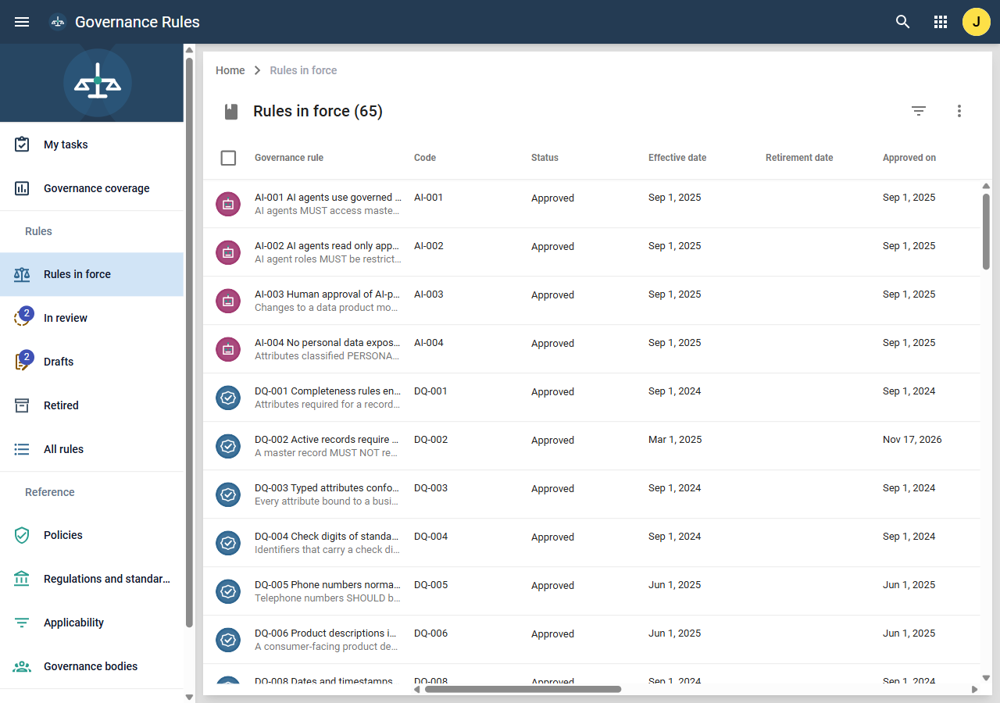

*The application opens on the rules in force, with the navigation drawer on the left. The Rules group has one entry per lifecycle view, with the number of rules in review and in draft.*

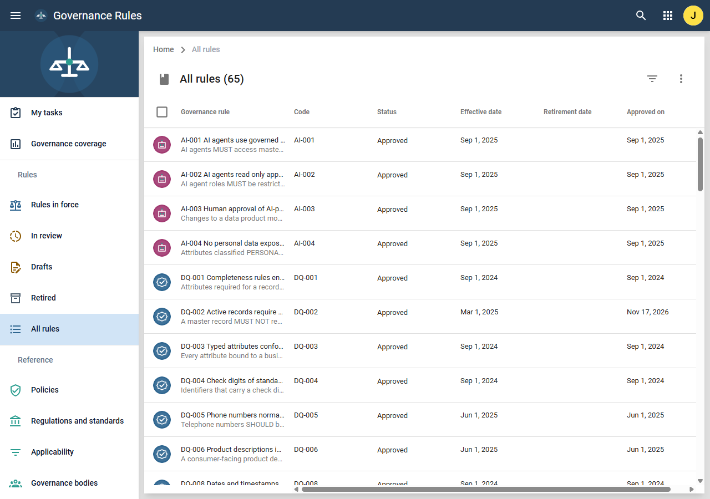

*A reader sees the same lists, restricted to the rules in force, with no authoring action.*

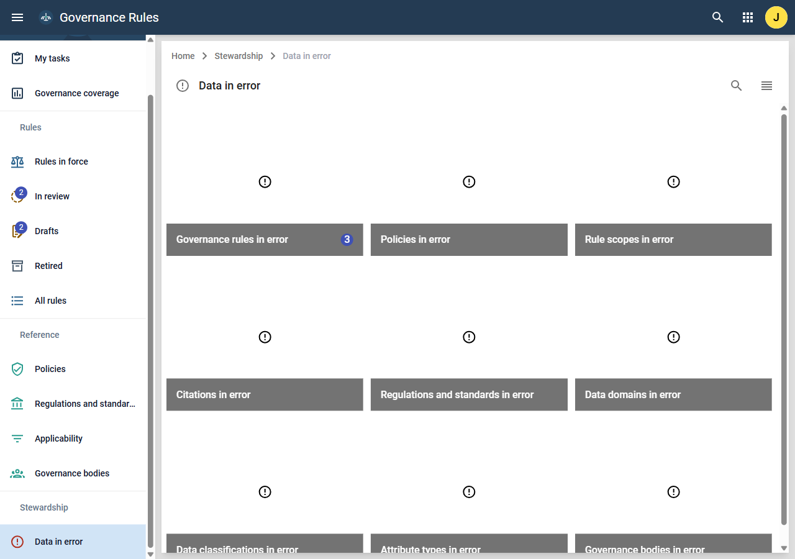

*Data in error (stewards only): one entry per entity, with the number of rejected records.*

Every rule view has the same rule screen: the form tabs **Definition** (rule text; classification: level, category, policy, owner; lifecycle: status, in force, dates, approval) and **Implementation** (pattern, guidance, example), plus the **Scope** and **Citations** tabs. The status, In force, Approved on and Approved by fields are read-only: the workflow and the enrichers set them. The rule search form filters on text, requirement level, category, implementation pattern, status, owner and policy. History browsing is enabled in the application.

See [Create an application](https://docs.semarchy.com/saas/guides/design/app-design/build/application) and [Create a business view](https://docs.semarchy.com/saas/guides/design/app-design/build/app-components/display-components/business-view).

### Authoring: the "New rule" stepper

The **New rule** action (and the **Edit** action) on governance rules opens the `NewGovernanceRule` stepper. It walks the author through four steps:

1. **Definition:** code, title, statement, rationale, level, category, policy, owner, dates.
2. **Implementation:** pattern, guidance, example.
3. **Scopes:** one or more scope rows (domain, classification, attribute type, each picked by name).
4. **Citations:** one or more citations (regulation, clause, note).

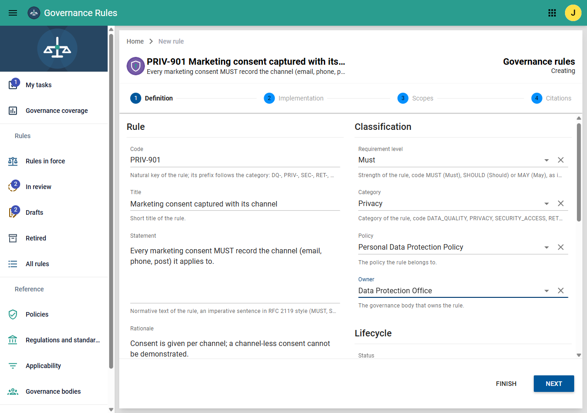

*Step 1 of the New rule stepper: the code, title, statement and rationale of the rule.*

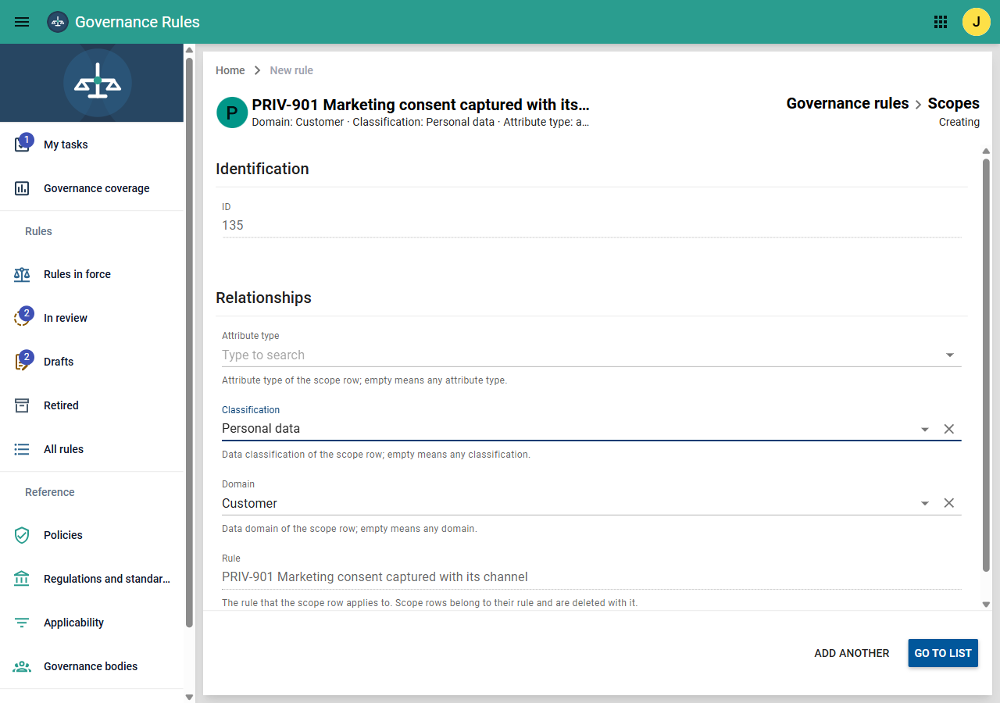

*Step 3 of the New rule stepper: a scope row on the Customer domain and the Email address attribute type.*

A new rule starts with status `DRAFT` (enricher `SetDraftStatus`). The date check `RetirementAfterEffective` runs as the user types and blocks leaving the Definition step if the dates are inconsistent. Saving the stepper certifies the rule with the `INTEGRATE_ALL` job, and the rule appears in **Rules › Drafts**, where the steward starts the review with **Request review**.

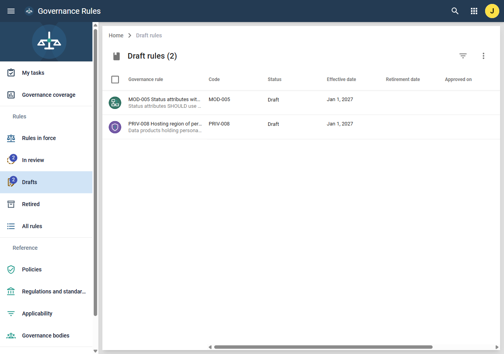

*Draft rules, ready for a review request.*

The reference entities (policies, bodies, regulations, domains, classifications, attribute types) and the scope and citation entities each have a simple authoring stepper (`Author<Entity>`) used by their Create, Edit, Mass update and Import actions.

See [Create a stepper](https://docs.semarchy.com/saas/guides/design/app-design/build/app-components/display-components/stepper).

### Rule review workflow

One workflow, **Rule review** ([RuleReview.Workflow.seml](../src/GovernanceRules/workflows/RuleReview.Workflow.seml)), covers the approval of a new rule, the approval of a change, and the retirement of a rule. A steward starts it with the **Request review** action on a rule.

| Workflow | Label | Root entity | Steps | Submit job | Admin role |
|---|---|---|---|---|---|
| RuleReview | Rule review | GovernanceRule (single record, from golden data) | Request a rule review (start, GovernanceSteward) → Prepare the review request (steward) → Notify the governance owner (email) → Approve the governance rule (owner) → Apply the decision (submit) → Notify the steward (approved / rejected) | INTEGRATE_ALL | GovernanceOwner |

How it runs:

1. **Prepare the review request** (task assigned to the steward who started the workflow, stepper "Request rule review"). The steward edits the rule, its scopes and citations. To ask for a retirement, the steward fills in the retirement date and the retirement reason. The `RequestReview` enricher sets the requested outcome: `RETIREMENT_REQUESTED` when both retirement fields are filled, `IN_REVIEW` otherwise. The steward then chooses **Submit for approval** (blocked if title, statement, level or category is empty, or if the dates are inconsistent) or **Cancel the request** (changes are discarded).

   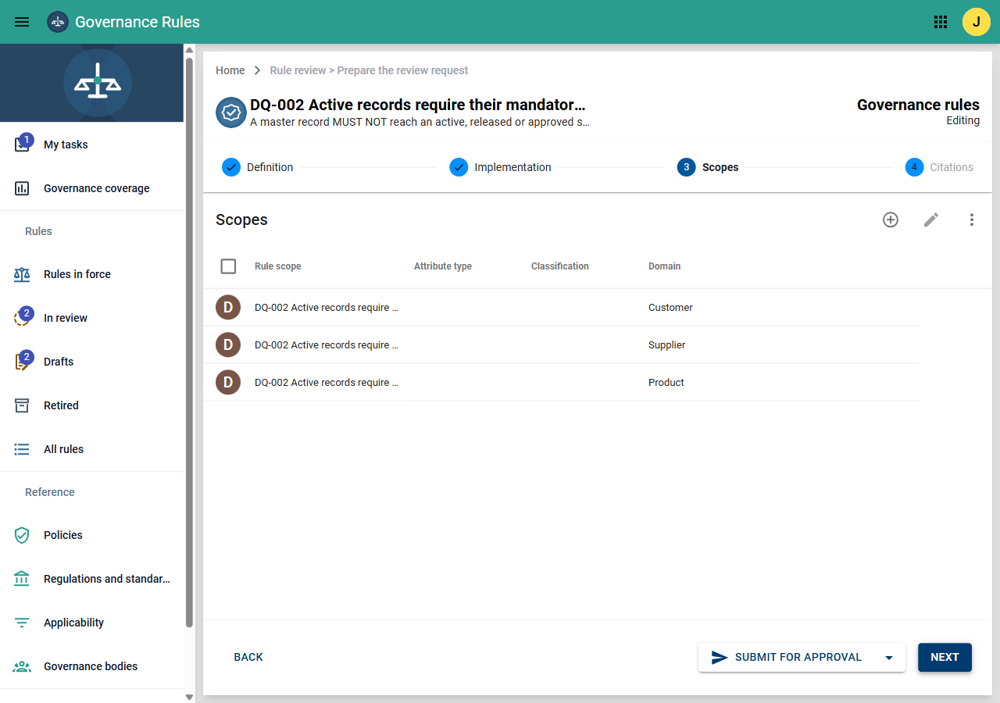

   *Prepare the review request: the steward edits the rule, then submits it for approval.*

2. **Notify the governance owner.** An email goes to every user with the `GovernanceOwner` role.
3. **Approve the governance rule** (task for a `GovernanceOwner`, stepper "Approve rule"). The owner reviews the Definition, Implementation, **Scopes** and **Citations** steps, all read-only: the owner decides, and asks the steward for changes with a rejection comment. When the form opens, the `ApproveRule` enricher prepares the decision: `RETIREMENT_REQUESTED` becomes `RETIRED`, anything else becomes `APPROVED`; Approved on is set to today, Approved by to the current user, and an empty effective date to today. The owner chooses:
   - **Approve:** blocked if the rule has no scope row (`ApprovedRuleHasScope`), if the dates are inconsistent, or if title, statement, level or category is empty. Then **Apply the decision** submits the rule with the `INTEGRATE_ALL` job, on behalf of the steward who started the workflow, and an email tells the steward.
   - **Reject:** a comment is required. The data of the approval task is reverted, so the prepared status and approval values are dropped and the rule goes back to the steward as it was submitted. An email tells the steward, and the task goes back to step 1, where the steward reworks and resubmits, or cancels.

   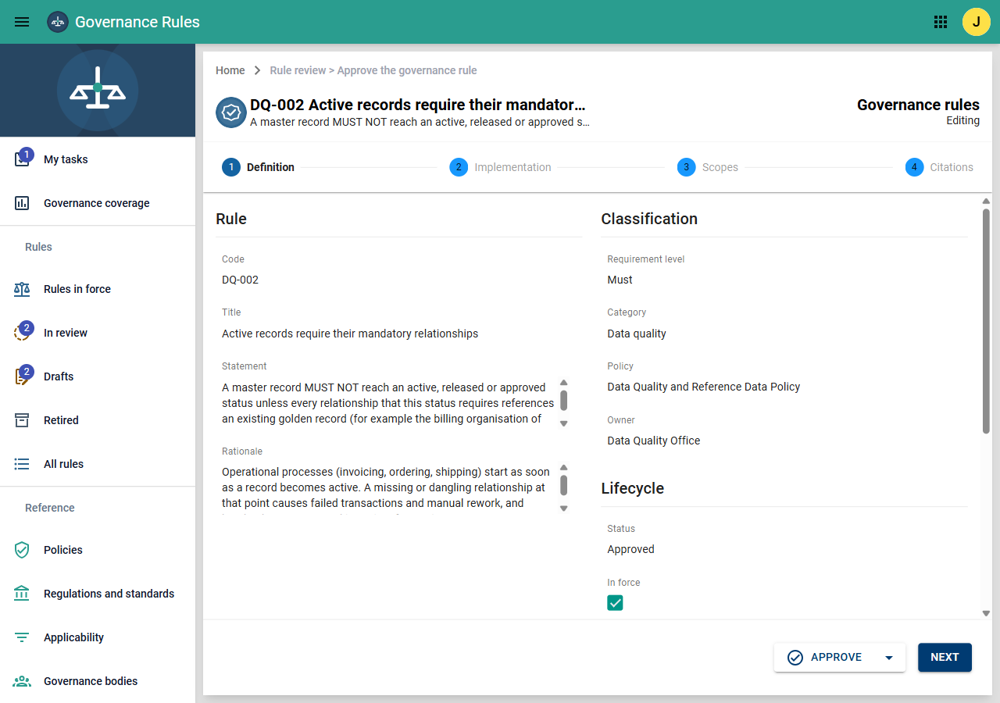

   *Approve the governance rule: the ApproveRule enricher has prepared the status and the effective date. The rule fields are read-only; the owner approves or rejects.*

**Scopes and citations in the workflow.** The workflow data scope includes the two child entities of the rule (`childEntities` on the RuleScopeHasRule and RuleCitationHasRule references). When the workflow starts on an existing rule, its certified scope rows and citations are loaded into the workflow with the rule: the steward sees and changes them in the Scopes and Citations steps of "Request rule review", the owner sees them read-only in "Approve rule", and **Apply the decision** submits them with the rule. Before this setting, only the rule itself was loaded and both steps showed an empty list.

**Who is recorded as the author of an approved change (for auditors).** **Apply the decision** submits the workflow data as a load whose submitter is the steward who started the workflow (`submitUserExpression: WorkflowInstance.InitiatorName`). The created by and updated by values of the certified rule, scope and citation records, and the load in the data location, therefore name the steward, not the approver. The approver is recorded only in the rule's **Approved by** attribute (with **Approved on**), and in the workflow instance history (who completed the approval task and when), which is kept forever. To audit an approval, read Approved by on the rule version in the rule history, or the workflow history.

Status lifecycle of a rule:

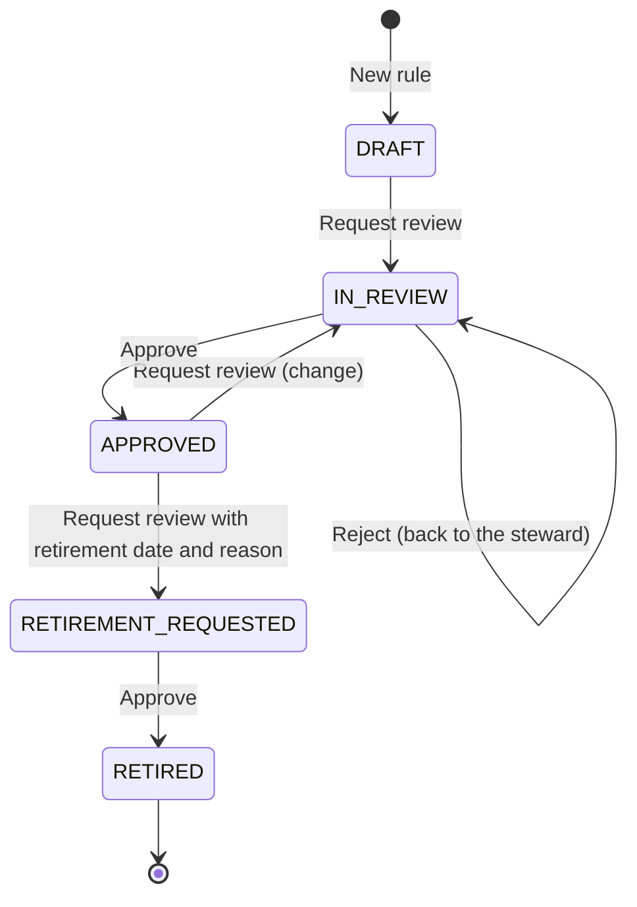

`IN_REVIEW` and `RETIREMENT_REQUESTED` are set inside the workflow data only. The golden record keeps its previous status until the owner approves (see [Known limitations](#known-limitations)).

Reference lists and policies have no workflow: the steward changes them directly. Scopes and citations are reviewed with their rule in the workflow, and can also be changed directly from the Scope and Citations tabs of a rule (see [Known limitations](#known-limitations)).

See [Design data management workflows](https://docs.semarchy.com/saas/guides/design/app-design/workflows).

### Validations

Data quality is kept light on purpose: mandatory fields (code and name on every reference entity; code, title, statement, level, category and status on rules), list of values checks, reference checks, and two business rules on the governance rule:

- **RetirementAfterEffective:** the retirement date, when set, is after the effective date.
- **ApprovedRuleHasScope:** an approved rule has at least one scope row.

Both are also blocking checks on the **Approve** transition of the Rule review workflow, and RetirementAfterEffective on **Submit for approval** too.

All run before consolidation. The full list is in [validations.md](./validations.md).

### Enrichers

- **ComputeInForce** (at certification) sets the `InForce` flag.
- **SetDraftStatus**, **RequestReview** and **ApproveRule** run only in the steppers, to set the status and the approval details along the workflow.

The full list with expressions is in [enrichers.md](./enrichers.md).

### Privileges and row filters

The privilege grants are in [src/GovernanceRules/privilege_grants](../src/GovernanceRules/privilege_grants). See [Secure the web application](https://docs.semarchy.com/saas/guides/design/app-design/security).

| Role | Governance rules | Scopes and citations | Policies, bodies, regulations, domains, classifications, attribute types | Other |
|---|---|---|---|---|
| GovernanceOwner | Read and write (checkout, export), no create, no delete | Read, export | Read, export | Approves in the Rule review workflow; workflow administrator. |
| GovernanceSteward | Read, write, create, export; **no delete** (rules are retired, never deleted) | Read, write, create, remove, export | Read, write, create, remove, export | Starts the Rule review workflow; integration role for REST loads; can see data quality and enrichment documentation. |
| GovernanceReader | Read, **in-force rules only** | Read, **only those of in-force rules** | Read; policies **with status `APPROVED` only** | No export. |
| GovernanceAgent | Read, **in-force rules only** | Read, **only those of in-force rules** | Read; policies **with status `APPROVED` only** | No export, no write. Meant for the AI agent user connected through MCP. |
| demo, demosemarchy | Read, **all rules, whatever their status** | Read | Read | Demo roles of the Semarchy accelerators sandbox tenant: global read in the application, no row filter, no write, no workflow task. Delete these two grants (`privilege_grants/demo*.seml`) if your platform has no such roles. |
| semarchyAdmin | Read, write, create, delete, export | Read, write, create, delete, export | Read, write, create, delete, export | Platform administrator of the Semarchy accelerators tenant: data administrator in the application and integration role, so the release process can load the demo data through the REST API. Delete this grant (`privilege_grants/semarchyAdmin.DataProductPrivGrant.seml`) if your platform has no such role. |

The row filter of the reader and agent roles on rules is:

```
LifecycleStatus = 'APPROVED' AND EffectiveDate <= CURRENT_DATE() AND (RetirementDate IS NULL OR RetirementDate > CURRENT_DATE())
```

The same condition, through `Rule.`, filters scopes and citations, and `LifecycleStatus = 'APPROVED'` filters policies. The filter uses the dates directly rather than the stored `InForce` flag, so a rule disappears for these roles on its retirement date even if nobody certifies it again.

### Named queries for AI agents

| Named query | Use |
|---|---|
| RuleChecklist | Compact list of the in-force rules for a whole design change: one domain, comma-separated classifications and attribute types. The recommended first call. |
| ApplicableRules | Full in-force rules (statement, citations, scopes) for one domain, classification and attribute type. |
| AttributeTypeCatalog | All attribute types with default classification, format pattern and reference standard. Used to classify attributes before asking for rules. |
| RuleDetail | One rule by code, with everything about it. |
| RulesByCategory | In-force rules of one category. |

Parameters, returned properties, filter semantics and the AI agent instructions of each query are in [named_queries.md](./named_queries.md).

### Certification job

| Model job | Type | Queue | Description |
|---|---|---|---|
| INTEGRATE_ALL | Integration | GovernanceRules | Certifies every entity in dependency order: GovernanceBody, DataDomain, DataClassification, Regulation, BusinessAttributeType, GovernancePolicy, GovernanceRule, RuleScope, RuleCitation. All certification phases are enabled. Used by REST loads, steppers and the Rule review workflow. |

See [Create certification jobs](https://docs.semarchy.com/saas/guides/design/certification/certif-execution/certification-jobs).

### Publishers

| Publisher | Code | Label | Active | Use |
|---|---|---|---|---|
| GOV | GOV | Governance app (authoring) | Yes | Records created and changed in the application and through the workflow. |
| SEED | SEED | Initial corpus load | Yes | The starting corpus, loaded through the REST API. |

See [Declare publishers](https://docs.semarchy.com/saas/guides/design/certification/declare-publishers).

### History and retention

Golden history is enabled on **GovernanceRule** only, so each approved version of a rule is kept and visible in its history. The data retention policy `GovernanceRetention` keeps:

| Data | Kept for |
|---|---|
| Golden history | 10 years |
| Deleted records | 2 years |
| Source data | 1 year |
| Source errors | 6 months |

Rule review workflow instances are kept forever, as an audit trail of approvals and rejections (see [who is recorded as the author of an approved change](#rule-review-workflow)). See [Configure data retention](https://docs.semarchy.com/saas/guides/design/data-lifecycle-mgmt/retention-policy) and [Enable data historization](https://docs.semarchy.com/saas/guides/design/data-lifecycle-mgmt/data-historization).

### Dashboard

The **Governance coverage** dashboard (Dashboard Builder application `GovernanceRulesAnalytics`, source in [resources/dashboards](../resources/dashboards/README.md)) is opened from the Quick access group. It has two pages:

- **Overview:** KPIs for rules in force, in review and in draft; rules by category and requirement level; rules by status.
- **Domain coverage:** the number of domains covered by generic rules only, the number of domain-specific rules per domain, and the domain and category pairs that have no domain-specific rule (with the number of generic rules that still apply to them). A rule whose scope rows have no domain is a generic rule: it applies to every domain but is not counted as domain-specific coverage. With the demo data, the Asset domain relies on generic rules only.

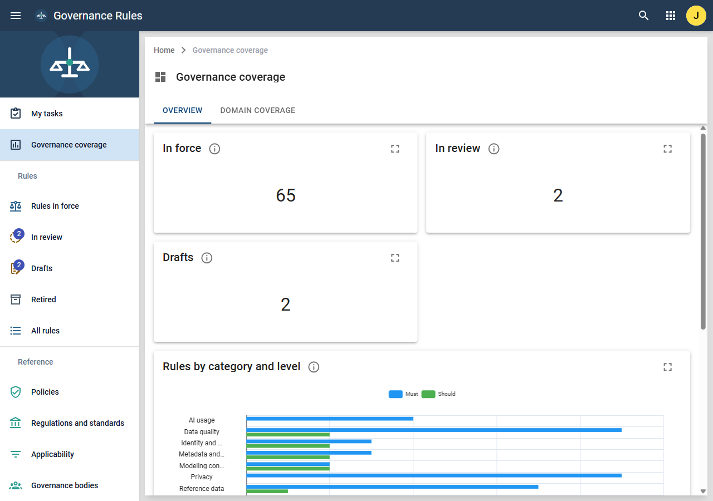

*The Overview page of the Governance coverage dashboard.*

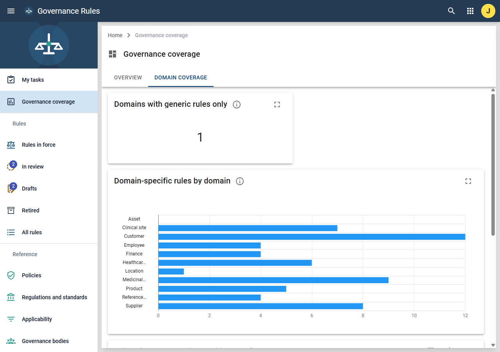

*The Domain coverage page: domains with generic rules only, and domain-specific rules by domain.*

See [Design dashboards](https://docs.semarchy.com/saas/guides/use/mdm-app/dashboards/design-dashboards) and [Using YAML for dashboards](https://docs.semarchy.com/saas/guides/use/mdm-app/dashboards/YAML-dashboards).

## Using the model with AI agents

The data product MCP server exposes the entities and the named queries of GovernanceRules to any MCP client. An AI agent that helps a designer change a data product (for example Claude Code with the Semarchy plugin) connects with a user holding only the `GovernanceAgent` role, and follows the instructions written in the descriptions:

1. classify each attribute it touches with **AttributeTypeCatalog**;
2. get the rules for the whole change with **RuleChecklist** (data domain, classifications, attribute types);
3. read the full text of a rule with **RuleDetail** when it needs to explain or quote it;
4. implement every MUST rule, apply SHOULD rules unless it states why not, and cite each applied rule code in the description of the object that implements it (for example `Rules: PRIV-003, DQ-001.`).

Because of the row filter, the agent can never apply a draft or retired rule. The `AI agent instructions:` paragraphs in the entity and named query descriptions are part of the model (the overall procedure is on the GovernanceRule entity; the data product description stays a short business summary, because the Data products catalog card shows it and hides descriptions longer than about 1,000 characters): keep them up to date when you change the queries.

A ready-to-use Claude Code skill that runs this procedure before and after a design change is in [resources/ai-agents/governance-check](../resources/ai-agents/governance-check/SKILL.md). The step-by-step setup and usage guide is [design_with_ai_agents.md](./design_with_ai_agents.md).

## Demo data and loading

The demo data is a generic corpus of governance rules anchored on real regulations and standards, with its policies, governance bodies, regulations, domains, classifications and attribute types, plus the pharma extension. It contains rules in each lifecycle status, so every view and the dashboard show something. The content is illustrative: review it with your governance office before you use it as a starting point.

Everything is in [resources/demo-data](../resources/demo-data/README.md):

- CSV files `data-files/NN-<Entity>.csv`, one per entity. The number gives the loading order (reference lists first, then policies, rules, scopes and citations).
- A single JSON payload for the REST API, `API Import-curl/GovernanceRules-demo-data.json`, loaded in one call with the publisher `SEED` and the `INTEGRATE_ALL` job.

Load it with the API key described in [Prerequisites](#prerequisites). The README of the demo data folder gives the commands. See [Create a load](https://docs.semarchy.com/saas/reference/api/dm/data/create-load) in the REST API reference.

## Work for developers

### Build and deploy

1. Clone the repository and open `use-case-models/GovernanceRules` as your workspace.
2. Complete the [prerequisites](#prerequisites) (roles, image library, dashboard).
3. Build the data product:

   ```
   sem-design data-product build --data-product-folder src/GovernanceRules
   ```

4. Deploy it to a data location (for example `GOVERNANCE_RULES`) on your datasource:

   ```
   sem-design data-product deploy --data-product-folder src/GovernanceRules \
     --instance-url https://<your-tenant> --data-source <datasource> --data-location GOVERNANCE_RULES
   ```

   Pass `--client-id` and `--client-secret` for OAuth client credentials when you run it from a pipeline. See the [Design CLI commands reference](https://docs.semarchy.com/saas/reference/cli/design-cli).
5. Load the demo data, open the Governance Rules application, and check the **In force** list and the coverage dashboard.
6. Connect an AI agent through the MCP server (see [design_with_ai_agents.md](./design_with_ai_agents.md)).

### Adapt the content

Most changes are data, not model changes:

- **Domains, classifications, attribute types, regulations, bodies:** add or change them in the application (Applicability, Regulations and standards, Governance bodies), or load them. New attribute types should have a default classification, a format pattern when one exists, and a reference standard.
- **Rules:** write them with the New rule stepper and send them through the Rule review workflow. Keep the code prefix aligned with the category, and give every approved rule at least one scope row.

Some changes touch the model:

- **New rule categories or implementation patterns** are list of values codes: edit `src/GovernanceRules/list_of_values/RuleCategory.LOVType.seml` or `ImplementationPattern.LOVType.seml`. Then update the descriptions that list the codes (GovernanceRule attributes, RulesByCategory) and the category list hard-coded in the dashboard queries (`resources/dashboards/GovernanceRulesAnalytics/queries/`), otherwise the new category is missing from the coverage matrix.
- **An industry pack** like the pharma one needs no model change: create the industry domains (for example `CARD_PAYMENT`) and attribute types (for example `PAN`), a policy and the rules, and scope every rule to those domains or attribute types. Never scope an industry rule with only a classification, or it will reach every design that handles that classification.

### Possible next steps

- **Compliance tracking:** add an entity that links a data product (and the object that implements the rule) to a rule code, with a compliance status and evidence. The `Rules:` citations that agents write in descriptions are a natural source to populate it.
- **Exceptions and waivers:** add a waiver entity (rule, data product, reason, expiry date, approver) with its own approval workflow, and let the named queries return the active waivers with the rules.
- **Stricter review:** see the known limitations below.

### Keep the model documented

The descriptions are the semantic layer that people and AI agents read. When you change the model:

- give every entity, attribute, reference, named query and privilege grant a meaningful description;
- keep the `AI agent instructions:` paragraphs of the entities and the named queries consistent with each other, and keep the data product description a short business summary (it is the text of the Data products catalog card);
- when an object implements a governance rule, end its description with the rule codes, for example `Rules: META-002, AI-002.` (the RuleChecklist query does this);
- rebuild, then update this documentation folder ([model_structure.md](./model_structure.md), [validations.md](./validations.md), [enrichers.md](./enrichers.md), [named_queries.md](./named_queries.md)).

### Known limitations

- **The review can be bypassed.** This is a deliberate choice that keeps authoring simple, but know its extent. The steward role has direct write access to rules, scopes and citations, and the **Edit** action uses the New rule stepper, which keeps the current status. A steward can therefore change the text of an approved, in-force rule without going through the Rule review workflow. A steward can also add, change or delete the scope rows and citations of an in-force rule from its Scope and Citations tabs (or with the RuleScope and RuleCitation actions), which changes where the rule applies and what reaches design agents, with no approval. The owner role also has direct write access to rules (it is the approval authority). To enforce the review, remove the update privilege of the steward on GovernanceRule, RuleScope and RuleCitation (keep create for new drafts) and route every change through the workflow, or restrict the Edit action to draft rules.
- **`IN_REVIEW` only exists inside the workflow.** The status is set in the workflow data, and the golden record is only updated when the owner approves. While a request is pending, the rule keeps its previous status (`DRAFT` or `APPROVED`), and the **In review** list only shows rules that were saved or loaded with that status. Follow pending requests in **My tasks** or in the workflow administration.
- **The approver is not the author of the load.** Every approved change is submitted as a load in the name of the steward who started the workflow; the approver is traced only in Approved by and in the workflow history. See [Rule review workflow](#rule-review-workflow).
- **`InForce` is refreshed at certification only.** The flag is computed when the rule is certified, so a rule that reaches its effective or retirement date keeps its old flag until it is certified again. The row filters, the In force list, the named queries and the dashboard use the status and the dates directly and are always correct; use the flag for display only, or schedule a job that recertifies rules daily if you need it exact.
- **The dashboard reads the golden tables directly.** Its SQL queries are not subject to the row filters of the data product, and the dashboard application has no required role, so any user who can open it sees counts of draft, in-review and retired rules. Set a required role on the dashboard application if that matters to you. The list of categories is also written in the two dashboard queries: update them when you add a category.
