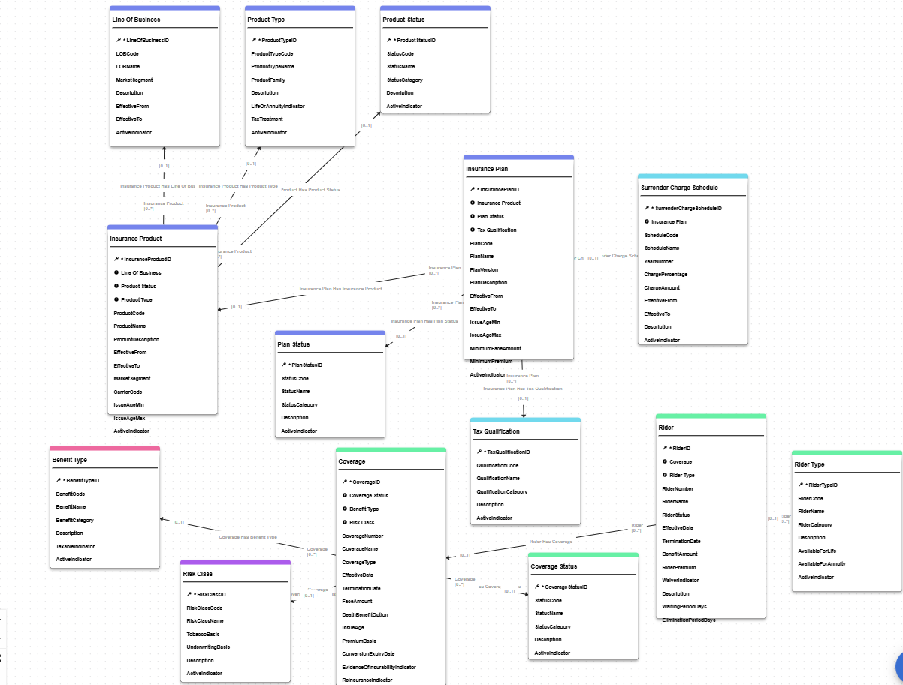
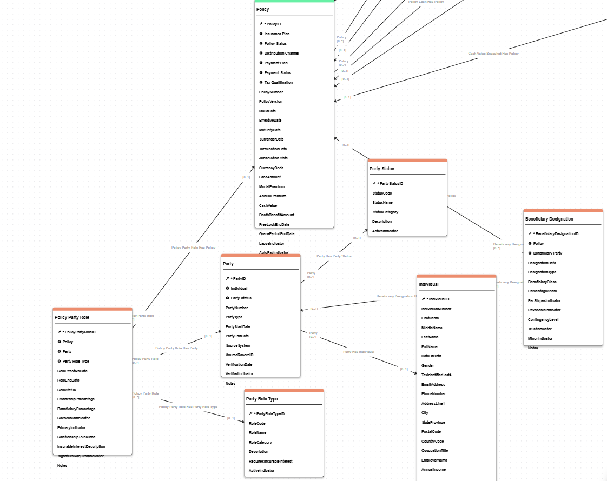
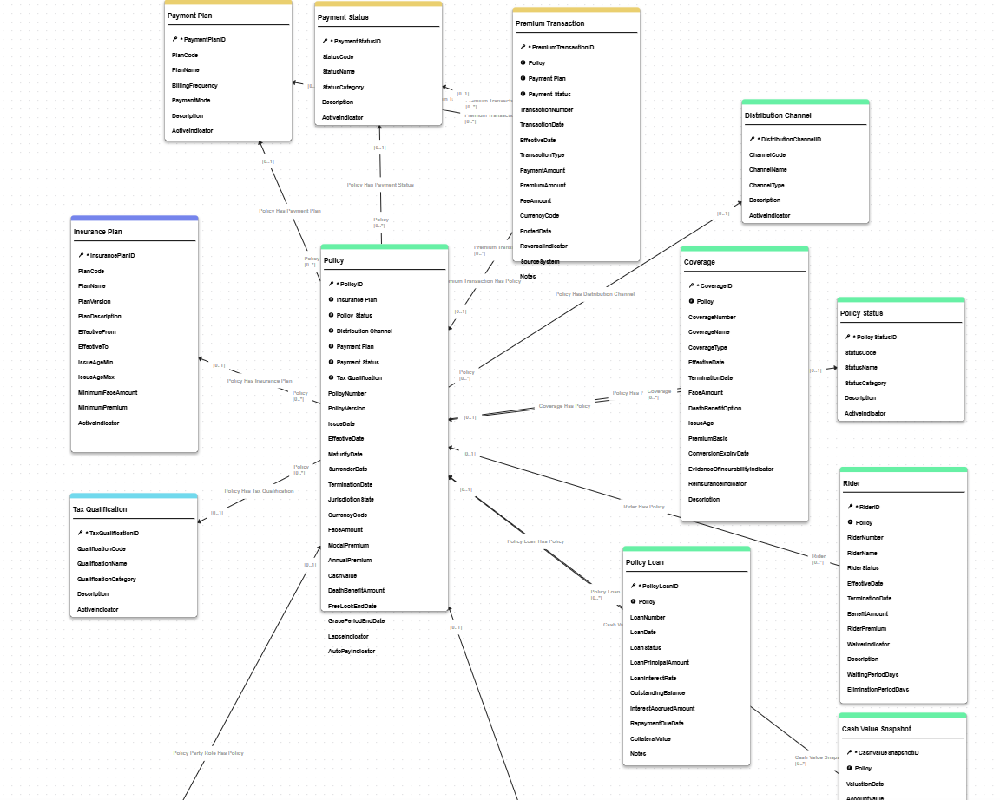
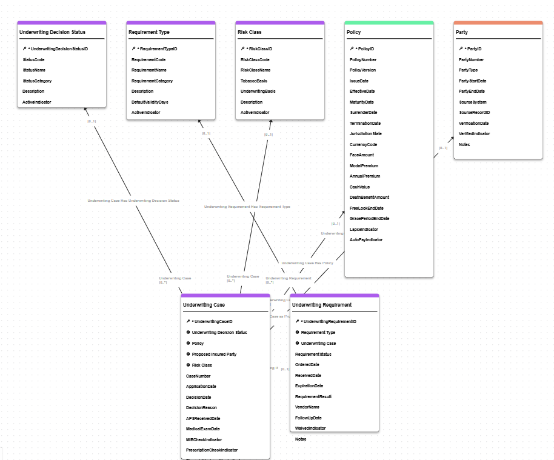
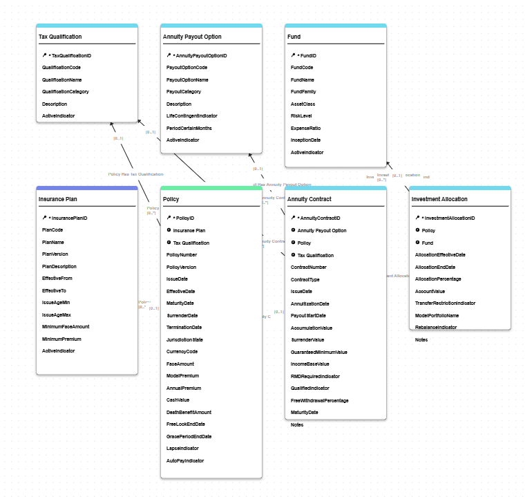

# Life and Annuity Insurance

The Life and Annuity (L&A) Insurance model delivers strong Master Data Management (MDM) value by creating a governed, enterprise-wide foundation for product, party, policy, annuity, underwriting, and claims data. From an MDM standpoint, its key strength is the way it separates and reconnects core domains: product configuration, party identity, policy administration, annuity value tracking, and claim benefit servicing. This supports a trusted 360 view while preserving operational context.

The model is built as a practical accelerator for Life and Annuity data domains and can be extended based on your carrier business requirements.

- **Data Consolidation:** Consolidates policy, coverage, rider, annuity, underwriting, and claims records into a trusted golden view.
- **Data Quality Controls:** Applies mandatory checks and SemQL validations to key entities before consolidation.
- **Reference Data Management:** Uses governed reference entities (for example, policy status, coverage status, payment status, party role type, risk class, tax qualification).
- **Product Governance:** Structures product configuration across Line Of Business, Insurance Product, Insurance Plan, Product Type, Product Status, Plan Status, Regulatory Test, and supporting references.
- **Party Mastering:** Supports fuzzy matching and stewardship for Individual and Party entities.
- **Extensibility:** Includes UI components, action sets, steppers, model diagrams, model jobs, and reference relationships that can be adapted for production use.

This model serves as a robust starter for L&A insurers seeking a single source of truth across product, policy, party, annuity, and claims data.

## Prerequisites

To correctly deploy and use this model in SDP DM, configure the following components:

- Bring a Self-Hosted or SaaS Semarchy Data Platform.
- Clone the repository in VS Code. Refer to VERSION_INFO.md to use the right Semarchy Design XP extension version.
- Open folder `\sdp-ps-accelerators\vertical-models\LifeAndAnnuityInsurance` in VS Code.
- Build and Deploy the model.
- Import image libraries by installing the Platform CLI and then executing (sample):

```
./sem dm admin image-library import life-annuity-ins -i ./life-annuity-ins.zip
```

- Publishers configured for source data:
  - `POL_ADMIN` (Policy Administration System)
  - `ANNUITY_ADMIN` (Annuity Administration System)
  - `CLAIMS_ADMIN` (Claims Administration System)
- Integration job available in the model:
  - `INTEGRATE_ALL`
- API access for load automation (if using API-based initial loads).
- Optional: application `LifeAndAnnuityInsuranceApplication` for business and stewardship workflows.

Sample data load assets are included under:

- `../resources/demo-data/UI Import/` (UI import CSVs)
- `../resources/demo-data/API Import-curl/LifeAndAnnuityInsurance.json` (API load payload)

## Model Structure

This model describes entities and relationships required to manage L&A products, policies, parties, annuity contract values, underwriting, and claims/benefits.

### Product Management


### Party and Identity Management


### Policy Administration


### Underwriting Management


### Annuity and Value Management



The model is organized around:

- Product hierarchy entities (Line Of Business, Insurance Product, Insurance Plan)
- Party and identity entities (Individual, Party, Policy Party Role)
- Policy and billing entities (Policy, Coverage, Rider, Premium Transaction, Policy Loan)
- Annuity and cash value entities (Annuity Contract, Investment Allocation, Cash Value Snapshot, Surrender Charge Schedule)
- Underwriting entities (Underwriting Case, Underwriting Requirement)
- Claims entities (Claim, Claim Benefit Payment)
- Reference entities supporting controlled vocabularies and dimensions

You can extend this data model by adding your own entities and/or attributes.

### Line Of Business

This entity defines top-level insurance portfolio segmentation for Life and Annuity offerings.

Key attributes include:

- LOB code and name
- Effective date range
- Active flag

This entity is a **Basic** entity and is commonly used as an anchor for product governance and downstream hierarchy navigation.

### Insurance Product

This entity represents an offerable insurance product under a line of business.

Key attributes include:

- Product code and name
- Product lifecycle status
- Effective date range
- Product description and market segmentation attributes

Products are connected to Product Type, Product Status, and Line Of Business through references to support structured catalog management.

### Insurance Plan

This entity stores configured plans under each product and captures lifecycle and issue metadata.

Key attributes include:

- Plan code, plan name, and version
- Effective date range
- Issue age boundaries and minimum amount/premium fields
- Active indicator

Insurance Plans connect to Policy, Tax Qualification, Plan Status, and Surrender Charge Schedule.

### Policy

This entity represents the policy/contract lifecycle and premium-value measures for in-force and historical records.

Key attributes include:

- Policy number and version
- Issue, effective, maturity, surrender, and termination dates
- Premium, face amount, cash value, and death benefit values
- Jurisdiction, currency, and payment behavior indicators

Policy is an **ID matched** entity and is linked to policy status, payment plan, payment status, distribution channel, insurance plan, and tax qualification.

### Coverage

This entity represents policy-level life/annuity coverage components and benefit options.

Key attributes include:

- Coverage number, name, and type
- Effective and termination dates
- Face amount and death benefit option
- Issue age and premium basis
- Conversion and insurability indicators

Coverage links each policy to risk class, status, and benefit type context.

### Individual

This entity represents individual party identity and profile details.

It is a **Fuzzy matched** entity designed to reduce duplicate person records across source loads.

Main fields contributing to matching decisions are:

- TaxIdentifierLast4
- DateOfBirth
- FirstName and LastName
- EmailAddress
- PhoneNumber and PostalCode

**Matching Rules:**

1. **Tax ID Birth Date and Last Name** (Score: 100) - Matches on tax identifier last 4, birth date, and last name.
2. **Email Birth Date and Name** (Score: 94) - Matches on email address, birth date, first name, and last name.
3. **Phone Postal Birth Date and Name** (Score: 90) - Matches on phone, postal code, birth date, first name, and last name.

Duplicate stewardship is enabled through `ManageDuplicatesOnIndividual`.

### Party

This entity represents an umbrella wrapper that links individuals to policy and claims roles.

It is a **Fuzzy matched** entity focused on deduplicating party wrappers.

Main field contributing to matching decisions is:

- Linked Individual reference (`FID_Individual`)

**Matching Rule:**

1. **Exact Individual Reference** (Score: 100) - Matches party wrappers that reference the same mastered individual.

Duplicate stewardship is enabled through `ManageDuplicatesOnParty`.

### Annuity Contract

This entity represents annuity-specific contract details linked to policy.

Key attributes include:

- Contract number and type
- Annuitization and payout dates
- Accumulation, surrender, guaranteed minimum, and income base values
- Tax qualification and payout option linkage

Annuity Contract is an **ID matched** entity and connects policy administration to annuity servicing.

### Underwriting Case

This entity represents underwriting decision workflows tied to policy and proposed insured party.

Key attributes include:

- Underwriting case number and status
- Submission and decision dates
- Decision reason and notes
- Risk class and decision status linkage

Underwriting Case is an **ID matched** entity and is extended by Underwriting Requirement details.

### Claim

This entity represents claim events and adjudication status for life and annuity benefits.

Key attributes include:

- Claim number, type, and status
- Event, report, approval, and closure dates
- Claimed and approved amounts
- Contestability and denial context

Claim is an **ID matched** entity and connects to benefit type, claimant/insured party, and claim benefit payment.

### Reference Data

Reference entities in this model capture controlled dimensions used across product, policy, underwriting, annuity, and claims workflows. Examples include:

- ProductType, ProductStatus, PlanStatus
- PolicyStatus, CoverageStatus
- DistributionChannel
- PaymentPlan, PaymentStatus
- RiskClass
- UnderwritingDecisionStatus, RequirementType
- RiderType, BenefitType
- TaxQualification
- IndividualStatus, PartyStatus, EmploymentStatus, MaritalStatus

The model also includes LOV types for domain-specific enumerations:

- `Gender`
- `PartyType`

Most reference and product configuration entities are modeled as **Basic** entities, while operational transactional domains are modeled as **ID matched**, and party identity domains are modeled as **Fuzzy matched**.

## Model Components

### Product, Policy, and Servicing Hierarchy

This model illustrates a connected governance chain:

- Line Of Business -> Insurance Product -> Insurance Plan
- Policy -> Coverage -> Rider
- Policy -> Premium Transaction and Policy Loan
- Policy -> Annuity Contract -> Investment Allocation / Cash Value Snapshot
- Policy -> Claim -> Claim Benefit Payment

This separation allows product design, policy servicing, annuity administration, and claims operations to evolve independently while remaining fully linked.

### Party and Role Linkage Model

The model supports relationship-rich party context through:

- `PartyHasIndividual`
- `PolicyPartyRoleHasParty`
- `PolicyPartyRoleHasPartyRoleType`
- `PolicyPartyRoleHasPolicy`

This enables a unified person-to-policy-to-claim perspective for servicing and analytics.

### Model Diagrams

The application documentation configuration references multiple model diagrams:

- AllEntities
- Product
- Policy
- Annuity
- Claims
- Underwriting

These can be used to communicate model structure during design and implementation workshops.

### Complex Types

The `complex_types` folder is not present in this accelerator by default. You can add reusable structures (for example standardized address, suitability profile, or payout instruction payloads) as needed.

### Publishers

This model includes three publishers by default:

- **POL_ADMIN** - Policy Administration System
- **ANNUITY_ADMIN** - Annuity Administration System
- **CLAIMS_ADMIN** - Claims Administration System

You can add additional publishers (for CRM, billing, external underwriting, document management, or analytics systems) and tune survivorship priorities for your operating model.

### Enrichers

The integration job enables source and post-consolidation enrichment switches per entity. However, this accelerator currently does not ship dedicated custom Enricher objects (`*.Enricher.seml`).

You can introduce enrichers for:

- Party identity normalization and contact standardization
- Policy and product code normalization
- Underwriting status derivation and rule enrichment
- Annuity value enrichment and external valuation alignment
- Claims categorization and payment routing enrichment

### Validations

The model includes SemQL validations across key entities, including examples such as:

- Date range checks:
  - `PolicyDateRangeCheck`
  - `CoverageDateRangeCheck`
  - `RiderDateRangeCheck`
  - `PolicyPartyRoleDateRangeCheck`
  - `InvestmentAllocationDateRangeCheck`
  - `UnderwritingRequirementDateCheck`
- Amount and percentage checks:
  - `PolicyAmountCheck`
  - `CoverageAmountCheck`
  - `PremiumTransactionAmountCheck`
  - `ClaimAmountCheck`
  - `ClaimBenefitPaymentAmountCheck`
  - `BeneficiaryPercentageCheck`
  - `BeneficiaryDesignationPercentageCheck`
  - `PolicyLoanBalanceCheck`
- Process and timeline checks:
  - `AnnuityPayoutDateCheck`
  - `UnderwritingDecisionDateCheck`
  - `ClaimReportedDateCheck`
  - `PartyDateRangeCheck`

You can extend validations to enforce carrier-specific underwriting, suitability, replacement, and servicing business rules.

## Work for Developers

This data model is intended as an accelerator for Life and Annuity product and policy mastering. It can be used as an MVP baseline for design workshops and rapid implementation.

Key extension areas for DM developers include:

1. **User Interface.** The `LifeAndAnnuityInsuranceApplication` provides Product Management, Party Management, Policy Administration, Underwriting, Annuity and Values, Claims and Benefits, Stewardship, and Admin navigation. Extend with role-specific views, dashboards, and guided steppers.

2. **Party and Relationship Governance.** Extend role stewardship and lifecycle controls around Party, Individual, and Policy Party Role to improve identity quality and traceability.

3. **Matching Strategy.** Tune Individual and Party match rules for your data characteristics, tolerance thresholds, and false-positive/false-negative profile.

4. **Workflow Orchestration.** Expand authoring steppers and action sets for underwriting review, policy corrections, annuity servicing events, and claims processing.

5. **Integration with External Systems.** Add publishers and integration patterns for PAS, annuity admin, claims admin, CRM, billing, and downstream analytics systems.

6. **Advanced Analytics.** Build cross-domain L&A 360 views for customer lifecycle, policy value trajectory, underwriting outcomes, and claims/payment performance.

7. **Validation and Compliance Rules.** Extend SemQL validations for jurisdiction-specific controls, replacement rules, suitability checks, and tax qualification constraints.

8. **Data Standardization and Reuse.** Introduce reusable structures and enrichers for address, party identifiers, suitability signals, and payout instruction normalization.
